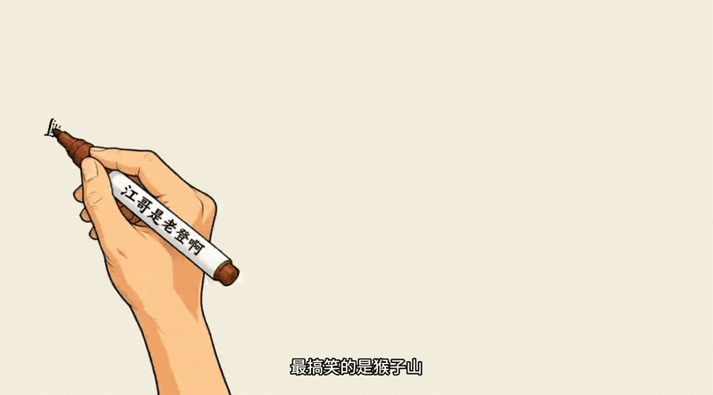

# SRT 白板动画 Skill

将 SRT 字幕转为按叙事顺序绘制的白板手绘视频Skill。它结合了**分区遮罩编排**与**流式笔迹绘制**：每个元素跟随字幕依次出场，笔尖在区域内连续落墨，再逐步添彩，最终导出 MP4。

适合把知识讲解、故事口播、课程字幕或短视频文案制作成暖米黄色纸张底的手绘动画。

## 效果示例

**场景：猴子山抢香蕉** —— 随着字幕的叙事顺序，依次绘制假山与小猴、抢香蕉的大猴，以及围观小朋友。



原始线稿：[查看 PNG](examples/scene-01-monkey-mountain.png)。

## 核心能力

- 解析 SRT 字幕，并按建议的 25–35 秒时长拆分场景
- 先输出分镜与配图策略，确保每一幕只表达一个核心意思
- 按字幕事件而非画面坐标，为元素建立语义化的绘制顺序
- 用 `annotation.json` 管理区域、时序、字幕关联和重叠保护区
- 每个区域采用连续流式笔迹：先 `ink` 铺线稿，再 `color` 添彩
- 支持浏览器预览台调整区域、顺序、时间和字幕关联
- 支持逐幕渲染与多幕合并，输出完整 MP4
- **可选配音**：锁定语速用字数反推幕长，TTS 逐句合成 + atempo 校正，严格按幕窗口对齐
- **可选字幕**：字幕文本 = 用户原文，逐字校验，按像素折行不丢字
- **可选配乐**：BGM 全片铺设但压低电平，语音读完留白处由音乐填充

## ⚠️ 开始前请先读

**[`references/production-lessons.md`](references/production-lessons.md)** —— 真实项目里所有失败案例的根因与正解。

包含：出图去色陷阱、建筑画成城堡、铅笔手锚点为 0 只露笔尖、豆包 TTS 资源 ID 与鉴权诊断、
**混音三重坑**、**幕号漏一导致后续全部错位**、字幕逐字校验等。跳过它会重复踩坑。

`scripts/` 下 `build_audio.py` + `make_project.py` 封装了**配音、字幕、音轨对齐、混音、量化校验**的完整流水线。

## 工作方式

该 Skill 的关键在于“字幕驱动、逐步确认”。每一步完成后都等待确认，避免在分镜、线稿或标注尚未定稿时浪费渲染成本：

1. 解析 SRT，输出分镜与配图策略。
2. 确认后生成统一风格的线稿。
3. 确认线稿后，结合字幕和原图创建标注，并载入预览台。
4. 确认标注后，生成分区与方向检查图。
5. 在预览台调整区域、叙事顺序、时序和字幕关联并保存。
6. 确认最终标注后，逐幕渲染 MP4。
7. 多幕项目在确认各幕成片后合并。

## 视觉规范

- 暖米黄色纸张背景：建议 `#F5EBD7`
- 深灰色素描线条，红、橙、蓝仅作少量概念性点缀
- 极简手绘、干净背景与充足留白
- 不使用场景文字、标签、摄影感、3D 效果或复杂纹理

## 安装与环境

Skill 自带独立的 Python 虚拟环境准备脚本。首次运行时执行：

```bash
python scripts/prepare_env.py --check
python scripts/prepare_env.py
```

成功后第一条命令会输出 `ENV_PY=<路径>`；后续渲染请使用该解释器，确保依赖隔离。

## 项目素材结构

```text
assets/whiteboard/<项目名>/
├── scene-01-<名称>.png
├── scene-01-<名称>.annotation.json
├── scene-01-<名称>-whiteboard.mp4
└── scene-01-<名称>-preview.mp4
```

图片与标注必须同名，例如 `scene-01-demo.png` 对应 `scene-01-demo.annotation.json`。

## 标注格式

每个元素使用原图的整数像素坐标，并通过 `sequence`、`subtitle` 与 `narrativeRole` 关联字幕中的事件。区域应按“场景铺垫 → 关键人物/物体 → 动作或变化 → 反应/结果”排序。

```json
{
  "sceneId": "scene-01",
  "canvas": { "width": 1672, "height": 941 },
  "storyBasis": "小猴在猴子山上拿着香蕉，大猴抢走香蕉，孩子们在旁观看。",
  "sceneDurationMs": 9000,
  "elements": [
    {
      "id": "rockery",
      "label": "猴子山场景",
      "sequence": 1,
      "narrativeRole": "故事的场景铺垫",
      "subtitle": "小猴子坐在猴子山顶，手里拿着香蕉。",
      "type": "structure",
      "region": { "x": 20, "y": 120, "width": 540, "height": 780 },
      "reveal": {
        "direction": "top_to_bottom",
        "startMs": 300,
        "durationMs": 2600,
        "maskPaddingPx": 22,
        "protectedRegions": []
      },
      "handPath": { "start": [290, 130], "end": [290, 890], "easing": "easeInOut" }
    }
  ]
}
```

`direction` 和 `handPath` 用于预览台的矩形代理；最终成片的真实笔迹由流式绘制器自动生成。对于相互遮挡的对象，在较早元素的 `protectedRegions` 中标出需要延后显示的区域，避免后续内容提前露出。

## 常用命令

解析字幕并生成建议分镜：

```bash
python scripts/parse_srt.py <字幕.srt> --target-sec 30 --min-sec 25 --max-sec 35
```

生成区域检查图：

```bash
python scripts/render_annotation_preview.py <图片路径> <标注路径> <预览图输出路径>
```

打开 `assets/preview.html`，使用“打开文件夹”载入场景目录，即可编辑区域、顺序、时间与字幕关联。

渲染单幕：

```bash
<ENV_PY> scripts/render_stream_whiteboard.py <图片路径> <标注路径> <输出.mp4> assets/drawing-hand.png \
  --ink-path grid --color-fill contour-wipe \
  --tip-anchor-x 0.21 --tip-anchor-y 0.68 --hand-height 280
```

> `--tip-anchor-x/y` 缺省为 `(0,0)`，会让笔尖素材被推出画布、只剩一小截。
> 内置素材实测笔尖在 `(0.21, 0.68)`。`--hand-height` 按画面大小调（线稿细腻时 240–320）。

### 端到端：给一段文字 → 出成品

```bash
# 1) 建项目（自动按中文标点分句，一句一幕）
python scripts/make_project.py --name my-video --dir<父目录> \
    --text "第一句话。第二句话。" --rate 4.25 --bgm audio/bgm/bg.mp3

# 2) 生成线稿 + 标注 JSON（见上文工作方式第2~5 步）

# 3) 渲染各幕并用 merge_scenes.py 合并

# 4) 配音 + 字幕 + 混音 + 校验（一条命令出成品）
export VOLC_API_KEY=<你的 X-Api-Key>
<ENV_PY> scripts/build_audio.py --project <父目录>/my-video all
```

产物：`<name>-final-subtitled.mp4`

分步调试：`plan`（时间轴）/ `tts` / `assemble` / `mix` / `verify`
常用参数：`--rate` `--voice` `--engine none`（自备音频）`--video` `--force`

**内置防错**（缺幕/越幕/重叠/字幕不符/音轨静音都会拦截并报错，不产出坏成片）——
详见 `SKILL.md` 的「端到端」章节与 `references/production-lessons.md`。

## 质量检查

- 首帧是干净的暖米黄纸张底色，没有提前露出的线条
- `canvas` 与原图尺寸一致，所有区域都是画布内的整数像素坐标
- `sequence`、`startMs` 与字幕的叙事顺序一致
- 中段帧中，未开始区域和保护区不会提前出现
- 笔尖贴近当前流式笔迹；线稿清晰时可选择 `--ink-path skeleton`
- 每幕结束后至少停留 0.5 秒完整画面；多幕合并顺序与字幕分镜一致
- **每幕结尾帧的墨迹覆盖率 ≈ 1.00**（量化验证遮罩不变量，不能只靠肉眼）
- 配音项目：语音单元数 == 幕数、无重叠无越幕、语音读完留白
- 字幕项目：`concat(字幕) == concat(原文)`，长句折行不丢字
- 测电平用 `ffmpeg -af volumedetect`，不要用 PyAV 算 RMS（会得到错误数值）

## 仓库内容

```text
srt-whiteboard-animation/
├── SKILL.md                        # 完整工作流与约束
├── README.md
├── assets/
│   ├── drawing-hand.png             # 手部素材（笔尖锚点 0.21/0.68）
│   ├── preview.html                  # 本地编辑预览台
├── examples/                         # README 案例素材
├── references/
│   └── production-lessons.md         # ★ 生产环境踩坑与用户偏好手册（先读这个）
├── scripts/
│   ├── make_project.py               # ★ 建项目脚手架（文字→config.json）
│   ├── build_audio.py                # ★ 配音/字幕/对齐/混音/校验流水线
│   ├── parse_srt.py                 # 字幕解析与分镜建议
│   ├── duotone.py                    # 双色调统一（去残留彩色）
│   ├── clean_watermark.py# 清除模型水印
│   ├── gen_annotations.py           # 批量生成标注 JSON
│   ├── grid_overlay.py              # 坐标网格叠加
│   ├── detect_regions.py            # 形态学分块（仅粗线稿）
│   ├── extract_pencil.py            # 从手部素材分离铅笔
│   ├── render_annotation_preview.py  # 标注检查图
│   ├── render_stream_whiteboard.py   # 流式笔迹 MP4 渲染器
│   ├── merge_scenes.py               # 多幕合并
│   └── prepare_env.py                # 依赖环境准备
└── agents/openai.yaml                # Codex 元数据
```

## 贡献

欢迎提交 Issue 或 Pull Request。任何涉及绘制逻辑的改动，都应使用真实的字幕、标注和成片检查遮罩保护、时序与最终画面。

## 许可证

本项目基于 MIT License 开源，详见 [LICENSE](LICENSE)。

## 关于作者

一个爱养鱼的老登 / AI Builder / 用 AI 团队打造一人公司。

抖音、B站、公众号：江哥是老登啊
